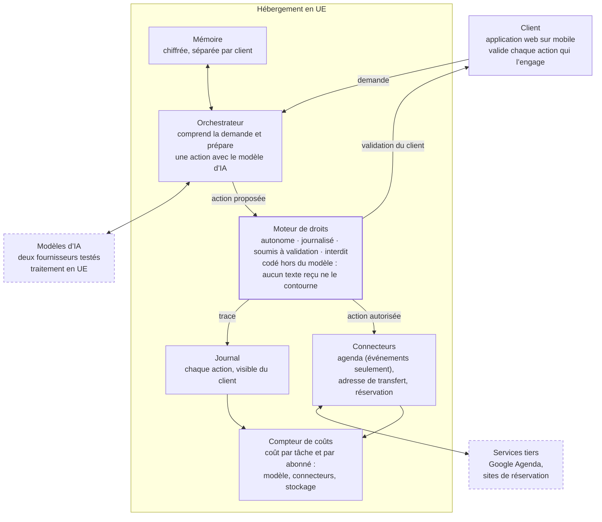

# Plan opérationnel — Super Majordome IA

**Date :** 27 octobre 2026  
**Fonction :** Opérations — responsable : Isaac K.  
**Statut :** proposition de l'assistant IA Opérations, soumise à approbation ; aucune décision n'est actée.

## 1. Objet, statut et sources

Ce plan organise les opérations du Super Majordome IA, de la découverte clients à la décision de lancement. C'est une proposition de l'assistant IA Opérations, soumise à l'approbation du responsable Opérations. Il n'engage aucun délai, aucun achat ni aucun fournisseur.

**Pièces utilisées** — dépôt HEC-Group4-Brain, état du 27 octobre 2026 à 19 h 49 :

- Business Model Canvas V2, dans `0 INBOX/`, pas encore classé ;
- Business plan Lean V1, Plan de travail Finance et Registre des hypothèses Finance, dans `2 FINANCE/PREVISIONS/` ;
- documentation Google et analyses de l'AI Act, listées au § 14.

**Changement de cible.** La V1 du canvas, retirée du dépôt à 19 h 28, visait les dirigeants de TPE-PME avec une offre Pro à 99 € HT. La V2 vise des cadres et des ménages aisés, avec une offre Premium à 79 € TTC. Ce plan suit la V2, seule version présente ; aucune des deux n'est inscrite au registre des décisions.

**Convention.** Une affirmation tirée d'une pièce cite cette pièce. Tout le reste est une proposition. Les chiffres des pièces sont des hypothèses de travail, pas des faits établis.

## 2. Mission et principes

Pendant le prototype et le pilote, les opérations doivent prouver trois choses : le service est fiable, son coût par abonné tient, et les clients peuvent lui confier leur vie personnelle. Ces trois points figurent parmi les risques de la V2 (BMC V2, § Risques et points à arbitrer). Ils recoupent deux points bloquants de la Finance : les actions réellement automatisables, et le volume d'actions par abonné avec son taux d'échec (Registre Finance, § Points bloquants).

**Principes directeurs**

1. **Prouver avant d'étendre.** Une fonction n'entre dans le produit que si le pilote mesure son usage, son taux de réussite et son coût.
2. **Le client garde la main.** Le majordome prépare ; il n'engage ni argent ni parole sans validation explicite. La V2 soumet déjà achats, paiements et engagements à autorisation (BMC V2, § Vision).
3. **Tout est tracé.** Chaque action du majordome laisse une trace que le client et l'équipe peuvent consulter.
4. **Aucune dépendance unique** : ni à un fournisseur de modèles, ni à une plateforme, ni à une personne de l'équipe.
5. **Mesurer au volume réel.** Le coût se mesure par tâche et par abonné dès le premier utilisateur, et se cite avec son volume.
6. **Prévu contre réel.** Chaque délai et chaque coût estimés sont comparés au constaté (`6 OPERATIONS/AGENT.md`).

## 3. Périmètre du MVP

Le MVP sert à 10 abonnés pilotes les quatre usages que la V2 veut prototyper (BMC V2, § MVP et validation). Ce sont les rendez-vous personnels, le suivi d'échéances, les réservations et la coordination familiale, par écrit, sur une application web utilisable sur mobile. Le tableau répond au premier point bloquant de la Finance : ce que le majordome fait réellement.

| Usage | Dans le MVP | Après le pilote | Raison |
|---|---|---|---|
| Rendez-vous personnels | Lire l'agenda, proposer des créneaux, créer l'événement après validation | Prise de rendez-vous directe chez des tiers | Une erreur chez un tiers se rattrape mal |
| Suivi d'échéances | Échéances saisies par le client ou transférées vers une adresse dédiée | Lecture automatique de la messagerie | Pas d'autorisation Google « restreinte » au MVP (§ 7) |
| Réservations | Recherche et préparation ; le client confirme et paie chez le prestataire | Réservation et paiement par le majordome | Aucune donnée de paiement manipulée |
| Coordination familiale | Agendas déjà partagés avec le client | Profils multiples, formule Family | Cloisonnement des données entre membres à éprouver |
| Canal | Messages écrits, application web | Applications iOS et Android, voix | Un seul développement, pas de validation des magasins d'applications |
| Assistance | Service automatique 24/7 ; assistance technique humaine aux heures ouvrées | Assistance étendue | Équipe réduite pendant le pilote |

**Adresse de transfert.** Le client transfère, ou fait transférer automatiquement par sa messagerie, les e-mails utiles : confirmations, convocations, factures. Le procédé marche avec toutes les messageries, pas seulement Gmail, et le client choisit ce qu'il partage.

**Pilote.** Les 10 abonnés se répartissent entre les trois personas de la V2. Le pilote mesure ce que la V2 demande : temps réellement gagné, rétention, fiabilité, coûts d'IA, satisfaction et incidents (§ 10).

## 4. Droits d'exécution du majordome

Le majordome agit selon quatre niveaux, calqués sur les droits des assistants du dépôt : autonome, journalisé, soumis à validation, interdit. C'est la réponse aux « permissions graduées » et à la traçabilité que demande la V2 (BMC V2, § MVP et validation). Ces règles sont codées hors du modèle d'IA, pour qu'aucune consigne ne puisse les contourner.

| Niveau | Ce que le majordome fait | Exemples au MVP | Contrôle |
|---|---|---|---|
| Autonome | Lire, résumer, rappeler, proposer | Résumé du jour, rappel d'échéance, trois créneaux proposés | Trace au journal |
| Journalisé | Modifier un élément du client, sans effet pour un tiers | Poser une option dans l'agenda, classer un e-mail transféré | Trace au journal, annulable par le client |
| Soumis à validation | Tout ce qui engage le client envers un tiers | Envoyer un message, accepter une invitation, créer un événement avec des invités | Récapitulatif, puis validation explicite action par action |
| Interdit au MVP | Argent, signature, suppression, partage | Payer, signer, supprimer un événement, partager un document | Bloqué par le code, pas seulement par consigne |

**Journal des actions.** Chaque entrée note la date et l'heure, l'action, son niveau, les données utilisées, la validation (qui, quand) et le résultat. Le client le consulte dans l'application ; l'équipe s'en sert pour mesurer la fiabilité (§ 10) et traiter les incidents (§ 7).

**Injection d'instructions.** Un contenu reçu, qu'il s'agisse d'un e-mail, d'un document ou d'une page web, n'est jamais une instruction pour le majordome. Une action qu'il suggérerait repasse par la grille, comme toute autre.

**Changement de niveau.** Faire passer une action d'un niveau à un autre est approuvé par les responsables Opérations et Produit, puis noté au registre des décisions.

## 5. Architecture et choix techniques

Le modèle d'IA ne fait que proposer : un moteur de droits, codé à part, autorise ou bloque chaque action, et le client valide ce qui l'engage. Tout est hébergé en UE, et chaque action laisse une trace et un coût.

**Le modèle propose, le moteur de droits décide, le client valide.** Architecture proposée du MVP, à approuver ; pointillés : prestataires externes.



Le client consulte le journal ; l'équipe lit le compteur de coûts pour le § 11.

| Choix | Proposition | Raison | Alternative écartée |
|---|---|---|---|
| Modèles d'IA | Modèles de fournisseurs, appelés par une couche qui permet d'en changer ; deux testés | Pas de dépendance unique ; coût et qualité comparés pendant le pilote | Modèle maison : coût et délai hors de portée |
| Hébergement | Cloud en région UE | Données de vie personnelle ; la V2 cite des hébergeurs européens | Hébergement hors UE : transferts à encadrer |
| Messagerie | Adresse de transfert dédiée | Aucune autorisation Google « restreinte », toutes messageries, le client choisit ce qu'il partage | Lecture de Gmail : vérification et audit de sécurité |
| Fichiers | `drive.file` et sélecteur Google, si besoin | Autorisation non sensible, limitée aux fichiers choisis | `drive.readonly` : autorisation restreinte |
| Droits | Moteur de règles dans le code | Une consigne donnée au modèle peut être contournée | Règles confiées au seul modèle |
| Paiement | Aucun au MVP ; le client paie chez le prestataire | Aucune donnée de carte manipulée, hors du champ des services de paiement | Paiement intégré dès le MVP |
| Interface | Application web utilisable sur mobile | Un seul développement, pas de validation des magasins d'applications | Applications natives dès le MVP |
| Infrastructure | Décrite en code, reproductible | Réversibilité, reprise possible par un autre prestataire | Configuration manuelle |

## 6. Fournisseurs et sous-traitants

Le MVP repose sur six catégories de fournisseurs. Aucun n'est choisi ni contracté, et la V2 ne présume aucun partenariat signé (BMC V2, § Partenaires clés). Chaque choix de fournisseur est soumis à l'approbation du responsable Opérations.

| Catégorie | Rôle au MVP | Critères de sélection | Contrat requis | Dépendance |
|---|---|---|---|---|
| Modèles d'IA | Comprendre les demandes, rédiger, résumer | Qualité sur les tâches du pilote, coût par tâche, traitement en UE, données non réutilisées pour l'entraînement | Contrat de sous-traitance RGPD (art. 28), encadrement des transferts hors UE | Élevée : deux fournisseurs testés |
| Hébergement cloud | Serveurs, mémoire, journal, compteur de coûts | Région UE, chiffrement, certifications de sécurité, réversibilité | Art. 28 | Moyenne : infrastructure décrite en code |
| Google | Agenda ; fichiers si nécessaire | Autorisations minimales (§ 7) | Conditions de Google sur les données des utilisateurs | Élevée : une seule plateforme d'agenda au MVP |
| Sites de réservation et de mobilité | Recherche, liens de réservation | Accès public ou API, conditions d'utilisation | Conditions d'API ; aucune commission présumée | Moyenne |
| Paiement de l'abonnement | Encaissement mensuel | Page de paiement hébergée, frais par transaction | Contrat du prestataire de paiement | Moyenne |
| Outils internes | Supervision, tickets, e-mails transactionnels | Hébergement UE, coût | Art. 28 s'ils traitent des données personnelles | Faible |

**Grille de choix** (pondération proposée, à valider) : qualité mesurée sur un jeu de tâches du pilote, 30 % ; coût par tâche au volume du pilote, 25 % ; conformité (UE, art. 28, non-réutilisation des données), 25 % ; réversibilité, 10 % ; assistance, 10 %.

**Règles de la fonction** (`6 OPERATIONS/AGENT.md`) :

- un devis n'est pas une commande, une commande n'est pas une livraison ;
- la capacité annoncée par un fournisseur n'est pas la capacité constatée ;
- un coût unitaire se cite avec son volume ;
- une note par fournisseur dans `6 OPERATIONS/FOURNISSEURS/` (offre, prix, délais, contrat), qui alimente aussi le registre des traitements (RGPD, art. 30).

## 7. Conformité et sécurité

Trois corps de règles encadrent le MVP : les règles de Google sur les données des utilisateurs, le RGPD et l'AI Act, dont les obligations de transparence s'appliquent depuis le 2 août 2026. Juridique RH qualifie ; les opérations mettent en œuvre et en apportent la preuve.

### Google : rester hors des autorisations « restreintes » au MVP

Lire ou rédiger des e-mails Gmail passe par des autorisations que Google classe « restreintes », comme la lecture de tout le Drive ([Gmail](https://developers.google.com/workspace/gmail/api/auth/scopes), [Drive](https://developers.google.com/workspace/drive/api/guides/api-specific-auth)). Si ces données passent par des serveurs, Google exige une vérification de l'application et un audit de sécurité par un évaluateur agréé, sur plusieurs semaines, à renouveler au moins tous les 12 mois ([vérification](https://developers.google.com/identity/protocols/oauth2/production-readiness/restricted-scope-verification)). En mode test, l'application est limitée à 100 testeurs, dont les autorisations expirent au bout de 7 jours ([audience](https://support.google.com/cloud/answer/15549945?hl=fr)).

D'où quatre choix pour le MVP :

- pas de lecture de Gmail : l'adresse de transfert la remplace (§ 3) ;
- fichiers, si besoin, par l'autorisation `drive.file` et le sélecteur de Google : autorisation non sensible, limitée aux fichiers choisis par le client ;
- agenda limité aux événements, classement de sensibilité à confirmer dans la console Google ;
- envoi d'e-mail : `gmail.send` est classée « sensible », ce qui impose une vérification mais pas d'audit ; au MVP, le message part de l'adresse du service après validation, ou le client l'envoie lui-même.

Si Gmail entre après le pilote, l'audit de sécurité devient un jalon du calendrier et une ligne du budget.

### RGPD

- **Rôle.** Envers ses abonnés, la société sera responsable du traitement ; ses fournisseurs seront ses sous-traitants (art. 28). À confirmer par Juridique RH.
- **Analyse d'impact (AIPD, art. 35)** avant le pilote : vie personnelle, technologie nouvelle, données de tiers, dont des enfants.
- **Données de santé.** Les rendez-vous médicaux peuvent révéler des données de santé (art. 9). Il faut un consentement explicite, ou exclure ces rendez-vous du pilote.
- **Tiers.** Proches et contacts présents dans l'agenda : information et minimisation à prévoir.
- **Droits des personnes.** Accès, rectification, effacement et portabilité traités dans le délai d'un mois (art. 12), procédure testée avant le pilote.
- **Conservation.** Une durée par catégorie : mémoire, journal, e-mails transférés.
- **Registre des traitements (art. 30)** tenu à jour avec les fournisseurs du § 6.

### AI Act

Les obligations de transparence de l'article 50 s'appliquent depuis le 2 août 2026 ; le règlement « Omnibus » sur l'IA ne les a pas reportées ([Goodwin](https://www.mondaq.com/uk/compliance/1826042/not-delayed-not-deferred-eu-ai-act-transparency-obligations-are-now-in-force), [SRD](https://www.srd-rechtsanwaelte.de/en/blog/digital-omnibus-ai-what-is-changing-in-the-ai-act)). Le délai de grâce jusqu'au 2 décembre 2026 vise les seuls systèmes mis sur le marché avant le 2 août 2026, ce qui n'est pas le cas du majordome.

- Les messages que le majordome adresse à des tiers le signalent.
- Juridique RH qualifie si les brouillons validés par le client relèvent du marquage des textes générés (art. 50, § 2), qui prévoit des exceptions.
- Le majordome ne relève a priori d'aucun usage « à haut risque » ; à confirmer par Juridique RH.

### Droit de la consommation

- Droit de rétractation de 14 jours pour l'abonnement souscrit en ligne.
- Résiliation en ligne « en trois clics », obligatoire en France.

### Socle de sécurité avant le pilote

- [ ] Double authentification sur tous les comptes de l'équipe : cloud, dépôt, fournisseurs
- [ ] Secrets dans un coffre dédié, jamais dans le code ni dans le dépôt
- [ ] Chiffrement des données au repos et en transit
- [ ] Accès d'administration nominatifs, au moindre privilège, détenus par deux personnes
- [ ] Cloisonnement des données entre clients, testé
- [ ] Sauvegardes chiffrées et restauration testée
- [ ] Revue de sécurité externe ou test d'intrusion
- [ ] Coupe-circuit : passer tous les majordomes en lecture seule en une commande

### Incidents

1. **Détecter** : alertes sur les erreurs, les actions bloquées et les coûts anormaux.
2. **Contenir** : coupe-circuit dès qu'une action non voulue est possible.
3. **Qualifier** : gravité, données personnelles touchées ou non.
4. **Notifier** : la CNIL sous 72 heures en cas de violation de données (art. 33), les clients concernés si le risque est élevé (art. 34).
5. **Corriger et apprendre** : note datée dans `6 OPERATIONS/PRODUCTION/`, prévu contre réel.

## 8. Organisation et gouvernance

Les opérations n'ont pas encore d'équipe : le business plan prévoit 36 000 € HT de développement full-stack et IA sans dire qui le réalise (Business plan Lean V1, § Budget MVP). Désigner ce responsable technique est la première décision d'organisation. Le plan d'équipe est d'ailleurs un point bloquant de la Finance (Registre Finance, § Points bloquants).

**Rôles opérationnels**

| Rôle | Mission | Titulaire |
|---|---|---|
| Responsable Opérations | Approuve fournisseurs, choix techniques et changements d'organisation ; tient le prévu contre réel | Isaac K. |
| Responsable technique | Architecture, code, mises en production | À désigner : interne, indépendant ou agence |
| Second administrateur | Détient en double tous les accès d'administration | À désigner |
| Référent conformité | AIPD, contrats, qualification AI Act, notifications | Juridique RH |
| Support du pilote | Accueil des abonnés, tickets, retours | À désigner |

**Matrice des responsabilités** — R réalise, A approuve, C est consulté, I est informé.

| Activité | Dir. | Fin. | Mkt | Ventes | Produit | Opér. | Jur. RH |
|---|---|---|---|---|---|---|---|
| Périmètre du MVP | C | C | C | I | A, R | C | C |
| Choix techniques et architecture | I | C | I | I | C | A, R | C |
| Choix et contrats des fournisseurs | I | C | I | I | I | A, R | C |
| AIPD, RGPD et AI Act | I | I | I | I | C | C | A, R |
| Recrutement des 10 abonnés pilotes | I | I | C | A, R | C | I | I |
| Accueil et support du pilote | I | I | C | C | C | A, R | I |
| Mesure du coût par abonné | I | A | I | I | C | R | I |
| Gestion des incidents | I | I | I | C | C | A, R | C |
| Passage d'une phase à l'autre | A, R | C | C | C | C | C | C |

**Rituels**

- Revue opérationnelle hebdomadaire de 30 minutes : indicateurs du § 10, incidents, prévu contre réel.
- Revue mensuelle des coûts avec la Finance : coût par abonné et par tâche, pour mettre à jour l'hypothèse H03.
- Revue de sécurité avant chaque passage de phase.
- Décisions inscrites au registre des décisions par la Direction, avec la pièce et le décideur.

**Dépendance aux personnes.** Le code vit dans un dépôt partagé, l'architecture est décrite dans `6 OPERATIONS/TECHNIQUE/` et les accès d'administration sont détenus en double. Aucun départ ne doit bloquer le service.

## 9. Feuille de route

Le plan avance en quatre phases, séparées par trois décisions de passage. Aucune pièce ne fixe de durée : celles du schéma sont des estimations, à comparer au réel. Le pilote dure deux cycles de facturation, le minimum pour observer une rétention.

**Trois décisions de passage avant tout lancement.** Durées estimées par l'assistant, non engageantes.

```mermaid
flowchart TB
    P1["1. Découverte · 4 semaines (estimation)<br/>20 à 30 entretiens et test manuel : tâches déléguées, fréquence, temps gagné<br/>En parallèle : responsable technique désigné, choix techniques soumis, analyse d’impact lancée"]
    G1{"Go prototype"}
    P2["2. Prototype · 10 à 12 semaines (estimation)<br/>Agenda, adresse de transfert, moteur de droits, journal des actions, compteur de coûts<br/>Socle de sécurité, contrats de sous-traitance signés, analyse d’impact conclue, tests internes"]
    G2{"Go pilote"}
    P3["3. Pilote payant · 8 semaines, soit deux cycles de facturation<br/>10 abonnés répartis entre les trois personas, revue hebdomadaire des indicateurs<br/>Mesures : temps gagné, rétention, fiabilité, coût par abonné, satisfaction, incidents"]
    G3{"Go lancement"}
    P4["4. Lancement et extensions · après la décision<br/>Ouverture au-delà du pilote, au prix et au périmètre revus selon les mesures (BMC V2)<br/>Puis, une à une : applications natives, Gmail avec audit Google, formule Family, voix"]
    P1 --> G1
    G1 -->|"au moins 20 entretiens · tâches à déléguer chiffrées · responsable technique désigné"| P2
    P2 --> G2
    G2 -->|"droits et journal testés · analyse d’impact conclue · contrats signés · sécurité vérifiée"| P3
    P3 --> G3
    G3 -->|"indicateurs du pilote au seuil fixé (§ 10) · coût par abonné mesuré · prix et périmètre revus"| P4
    classDef passage stroke-width:2px
    class G1,G2,G3 passage
```



Chaque passage est une décision humaine, inscrite au registre des décisions avec ses preuves.

| Phase | Livrables des opérations | Critère de sortie | Décideur |
|---|---|---|---|
| 1. Découverte | Test manuel : 3 à 5 prospects confient leurs tâches à une adresse dédiée, l'équipe les traite à la main ; il mesure la demande, pas le produit. Liste chiffrée des tâches à automatiser ; architecture et fournisseurs soumis à approbation ; AIPD lancée | Go prototype : au moins 20 entretiens (BMC V2), tâches chiffrées, décisions D1 à D6 prises | Direction |
| 2. Prototype | Connecteurs, moteur de droits, journal, compteur de coûts ; socle de sécurité ; contrats de sous-traitance ; AIPD conclue ; tests internes sur des scénarios réels | Go pilote : aucune action interdite exécutée en test, seuils du § 10 fixés, sécurité vérifiée | Direction |
| 3. Pilote payant | Accueil des 10 abonnés, support, revue hebdomadaire, rapport de coûts mensuel à la Finance | Go lancement : indicateurs au seuil, coût par abonné mesuré, prix et périmètre revus | Direction |
| 4. Lancement et extensions | Montée en charge ; extensions une à une | Chaque extension : usage, taux de réussite et coût mesurés avant la suivante | Direction, Produit |

## 10. Indicateurs de pilotage

Dix indicateurs pilotent le prototype et le pilote ; leurs cibles sont des propositions, à fixer avant le passage « Go pilote ». À 10 abonnés, un seul départ pèse 10 % : le pilote donne des signaux, pas des statistiques.

| Indicateur | Calcul | Fréquence | Cible proposée (à valider) |
|---|---|---|---|
| Tâches réussies sans correction | Tâches menées à bien sans reprise ÷ tâches lancées | Hebdomadaire | ≥ 85 % en fin de pilote |
| Corrections par le client | Tâches reprises ou annulées par le client ÷ tâches lancées | Hebdomadaire | ≤ 10 % |
| Actions interdites exécutées | Nombre, d'après le journal | Continue | 0, sans exception |
| Temps gagné déclaré | Heures gagnées par semaine, selon un questionnaire | Hebdomadaire | À fixer par Produit |
| Actions par abonné | Actions du mois ÷ abonnés actifs | Mensuelle | Mesure seule, pour le point bloquant 2 de la Finance |
| Coût variable par abonné actif | Formule du § 11 | Mensuelle | ≤ 18 € HT (Registre Finance, H03) |
| Rétention | Abonnés du début de mois encore actifs en fin de mois ÷ abonnés du début de mois | Mensuelle | À lire face à l'hypothèse de 3 % de départs par mois (H05) |
| Satisfaction | Note de recommandation mensuelle | Mensuelle | À fixer par Marketing |
| Incidents | Nombre par gravité, délai de résolution | Hebdomadaire | 0 violation de données |
| Jalons tenus | Date prévue contre date réelle | Hebdomadaire | Écart signalé dès qu'il dépasse une semaine |

Le journal des actions (§ 4) et le compteur de coûts (§ 11) fournissent la plupart de ces mesures sans saisie. Le temps gagné et la satisfaction viennent d'un court questionnaire aux abonnés.

## 11. Coût par abonné

Le coût variable cible est de 18 € HT par abonné et par mois (Registre Finance, H03, non vérifié), contre 25 € dans la V1. Le compteur de coûts le mesure dès le premier abonné, tâche par tâche.

```math
\text{Coût variable par abonné actif} = \frac{\text{Modèles d'IA} + \text{Connecteurs et API} + \text{Cloud et stockage variables} + \text{Frais de paiement} + \text{Support}}{\text{Abonnés actifs du mois}}
```

| Poste | Ce que l'on mesure | Source de la mesure | Point d'attention |
|---|---|---|---|
| Modèles d'IA | Jetons consommés × prix du fournisseur | Compteur, à chaque appel | Croît avec l'usage (BMC V2, § Risques et points à arbitrer) |
| Connecteurs et API | Appels facturés | Compteur | Selon les conditions de chaque API |
| Cloud et stockage | Part variable : mémoire, journal, e-mails transférés | Facture cloud ventilée | La part fixe relève des charges fixes |
| Frais de paiement | Frais du prestataire sur l'abonnement | Relevés du prestataire | Inclus dans H03 selon le Registre Finance |
| Support | Temps passé × coût horaire | Outil de tickets | Poids élevé et peu représentatif à 10 abonnés |

**Coût par tâche.** Le compteur ventile aussi par type de tâche : rendez-vous, échéance, réservation, coordination. C'est le « coût par tâche » que demande le chantier Unit economics de la Finance (Plan de travail Finance, § Chantiers et livrables).

**Effet du volume.** Un coût mesuré sur 10 abonnés ne vaut pas pour 800, le scénario de l'an 2 (Registre Finance, H06). Remises de volume, poids du support et mise en cache changent la donne : chaque coût est publié avec son volume.

**Seuil d'alerte.** Un abonné qui dépasse 18 € HT sur un mois déclenche une revue de ses usages. Les usages intensifs relèvent des « options de consommation intensive » prévues par la V2 (BMC V2, § Sources de revenus).

### Budget du MVP : lecture opérationnelle

Le total de 77 050 € HT est arithmétiquement juste : 67 000 € de postes, plus 15 % d'imprévus, soit 10 050 € (Business plan Lean V1, § Budget MVP). Trois postes manquent du point de vue des opérations :

- l'exploitation du pilote, distincte de l'infrastructure de développement : environ 180 € HT par mois pour 10 abonnés selon H03 ;
- l'audit de sécurité Google, seulement si Gmail entre dans le produit, sur devis d'un évaluateur agréé ;
- la cyber-assurance et la responsabilité civile professionnelle.

## 12. Registre des risques

Dix risques opérationnels sont revus chaque semaine ; les cotations sont des estimations de l'assistant, à revoir en équipe.

| Risque | Probabilité | Impact | Parade | Responsable |
|---|---|---|---|---|
| Action non voulue du majordome, par erreur ou injection d'instructions | Moyenne | Élevé | Moteur de droits codé, validation des engagements, coupe-circuit | Opérations |
| Violation de données personnelles | Faible | Très élevé | Chiffrement, accès minimaux, AIPD, procédure 72 h | Opérations, Juridique RH |
| Données de santé révélées par des rendez-vous médicaux | Élevée | Élevé | Consentement explicite ou exclusion du pilote | Juridique RH |
| Coût par abonné au-dessus de 18 € HT | Moyenne | Élevé | Compteur dès le premier abonné, deux fournisseurs, seuil d'alerte | Opérations, Finance |
| Dépendance à un fournisseur de modèles : prix, panne, conditions | Moyenne | Élevé | Couche d'abstraction, second fournisseur testé | Opérations |
| Dépendance à une personne, par exemple un développeur unique | Élevée | Élevé | Dépôt partagé, accès en double, architecture documentée | Opérations, Direction |
| Retard ou refus de Google sur les autorisations | Faible au MVP, élevée ensuite | Moyen | Pas de Gmail au MVP, `drive.file`, audit anticipé avant toute extension | Opérations |
| Glissement du calendrier du prototype | Moyenne | Moyen | Périmètre fermé, prévu contre réel chaque semaine, critères de passage | Opérations |
| Défaut de transparence au titre de l'AI Act | Faible | Moyen | Mention de l'IA dans les messages aux tiers, qualification du marquage | Juridique RH |
| Pilote trop petit pour conclure | Certaine | Moyen | Lire les résultats comme des signaux, entretiens de sortie | Direction, Produit |

## 13. Décisions à prendre

Neuf décisions conditionnent le démarrage ; elles reviennent aux humains et s'inscrivent au registre des décisions. Six sont à prendre avant le passage « Go prototype ».

| N° | Décision | Option proposée | Décideur | Avant |
|---|---|---|---|---|
| D1 | Retenir la V2 (B2C premium) comme base du plan | Oui | Direction | Maintenant |
| D2 | Qui développe : interne, indépendant ou agence | À arbitrer dans l'enveloppe de 36 000 € HT | Direction, Opérations | Go prototype |
| D3 | Grille des droits d'exécution | Grille du § 4 | Opérations, Produit | Go prototype |
| D4 | Gmail hors MVP, adresse de transfert à la place | Oui | Opérations, Produit | Go prototype |
| D5 | Aucun paiement par le majordome au MVP | Oui | Direction | Go prototype |
| D6 | Fournisseurs de modèles et hébergeur | Deux fournisseurs de modèles, hébergement en UE, choix par la grille du § 6 | Opérations | Go prototype |
| D7 | Rendez-vous médicaux et données de santé | Consentement explicite à l'inscription ; à défaut, exclusion | Juridique RH | Go pilote |
| D8 | Seuils des indicateurs | Cibles du § 10 | Direction, Opérations, Finance | Go pilote |
| D9 | Extensions après le pilote : applications natives, Gmail, Family, voix | Une à une, selon les mesures | Direction, Produit | Go lancement |

## 14. Sources et points non établis

**Pièces du dépôt**, lues le 27 octobre 2026 :

- [Business Model Canvas V2](https://github.com/malikmubashir/hec-group4-brain/blob/main/0%20INBOX/2026%25201027%2520Business%2520Model%2520Canvas%2520Super%2520Majordome%2520IA%2520V2.md)
- [Business plan Lean V1](https://github.com/malikmubashir/hec-group4-brain/blob/main/2%20FINANCE/PREVISIONS/2026%201027%20Business%20plan%20Lean%20V1.md)
- [Plan de travail Finance](https://github.com/malikmubashir/hec-group4-brain/blob/main/2%20FINANCE/PREVISIONS/2026%201027%20Plan%20de%20travail%20Finance.md)
- [Registre des hypothèses Finance](https://github.com/malikmubashir/hec-group4-brain/blob/main/2%20FINANCE/PREVISIONS/2026%201027%20Registre%20des%20hypotheses%20Finance.md)
- [Règles du dépôt](https://github.com/malikmubashir/hec-group4-brain/blob/main/RULES.md) et [rôle de l'assistant Opérations](https://github.com/malikmubashir/hec-group4-brain/blob/main/6%20OPERATIONS/AGENT.md)

**Pages consultées** le 27 octobre 2026 :

- [Google — autorisations de l'API Gmail](https://developers.google.com/workspace/gmail/api/auth/scopes)
- [Google — autorisations de l'API Drive](https://developers.google.com/workspace/drive/api/guides/api-specific-auth)
- [Google — vérification des autorisations restreintes](https://developers.google.com/identity/protocols/oauth2/production-readiness/restricted-scope-verification)
- [Google — audience de l'application et mode test](https://support.google.com/cloud/answer/15549945?hl=fr)
- [Goodwin (Mondaq) — obligations de transparence de l'AI Act en vigueur](https://www.mondaq.com/uk/compliance/1826042/not-delayed-not-deferred-eu-ai-act-transparency-obligations-are-now-in-force)
- [SRD Rechtsanwälte — Omnibus numérique sur l'IA](https://www.srd-rechtsanwaelte.de/en/blog/digital-omnibus-ai-what-is-changing-in-the-ai-act)

**Points non établis**

- Durées des phases : estimations de l'assistant ; aucune pièce ne les fixe, la V2 n'en donne pas.
- Classement de sensibilité des autorisations Agenda de Google.
- Coût de l'audit de sécurité Google : sur devis.
- Volume d'actions par abonné et taux d'échec : à mesurer pendant le pilote.
- Responsable technique et plan d'équipe.
- Rôle RGPD de la société et qualification AI Act des brouillons (art. 50, § 2) : Juridique RH.
- Droit de la consommation (§ 7) : rappelé sans vérification de source, à confirmer par Juridique RH.

## Liens

- [[2026 1027 Business plan Lean V1]]
- [[2026 1027 Plan de travail Finance]]
- [[2026 1027 Registre des hypotheses Finance]]
- [[2026 1027 Demande de cadrage Produit Technique]]
- [[REGISTRE DES DECISIONS]]
- [[RULES]]
